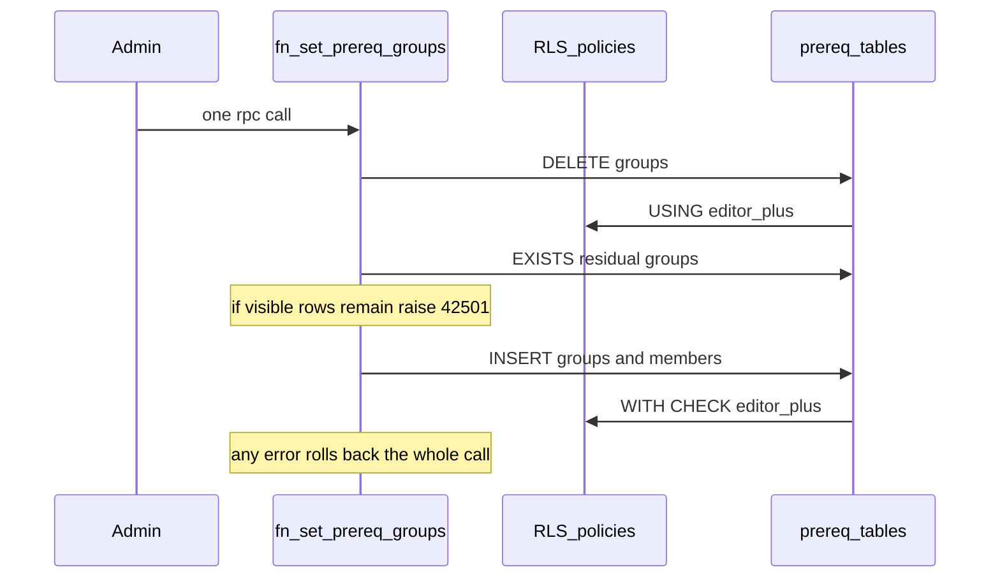

# H3 — Atomic prerequisite and character saves (admin)

**Lane A · Platform.** Closes audit ADM-1. Plan only on this branch; implementation follows after F1.

Sources: audit ADM-1; Claude plan review (empty-payload writer gap, ServerActionForm on both forms, `{ ok: false, error }`); existing RLS in `20261120045448_rls.sql`; geo-setter pattern in `20261121140003_m3c_geo_setters.sql`.

---

## Preconditions

- Work on `a/h3-atomic-saves` from `origin/master`.
- Do not touch other lane branches.
- Keep the local Supabase stack running (Lane B phones use it). Ask Jordan before any db reset.
- Leave untracked `docs/briefs/A9-sentry-scrubbing.md` alone.

---

## Problem

[`savePrereqGroups`](../../apps/admin/src/app/(shell)/story/groves/actions.ts) and [`saveFragmentCharacters`](../../apps/admin/src/app/(shell)/story/groves/actions.ts) delete then insert across several PostgREST round-trips. If one write fails mid-loop, the fragment is left with half-saved rules.

---

## Migration

**File:** `supabase/migrations/20261127160000_h3_atomic_prereq_character_saves.sql`

**Order:** after the latest migration on `origin/master`, `20261125120000_m11_dashboard_views.sql`. Timestamp `20261127160000` sorts after every migration currently on master (last five: `…a5_admin_zone_boundary`, `…a5p2a_run_jobs_apikey_only`, `…a5p2b_landcover_sha`, `…m11_events_schema_version`, `…m11_dashboard_views`).

**Staging / data risk:** create-or-replace functions and grants only. The migration must **not** rewrite, update, or delete existing story rows.

### CASCADE confirmation

`fragment_prereq_members.group_id` references `fragment_prereq_groups(id)` **`on delete cascade`** ([`20261120045439_story.sql`](../../supabase/migrations/20261120045439_story.sql) L139–144). Deleting groups for a fragment is enough; members go with them. No explicit member delete required. If a future migration ever drops that CASCADE, delete members explicitly before groups.

### `fn_set_prereq_groups(p_fragment_id uuid, p_groups jsonb) returns void`

```
language plpgsql
volatile
security invoker
set search_path = ''
```

**Input validation (raise `22023` on bad shape):**

1. `p_fragment_id` is not null.
2. `jsonb_typeof(p_groups) = 'array'`.
3. Each element is a jsonb object with key `members` that is a jsonb array.
4. Every member value casts cleanly to `uuid`.

**Body (single function call = one transaction):**

1. `DELETE FROM public.fragment_prereq_groups WHERE fragment_id = p_fragment_id`  
   (members removed by CASCADE).
2. **RLS-based writability check (closes empty-payload writer gap):**  
   After the DELETE, if any `fragment_prereq_groups` row for `p_fragment_id` is still visible to the caller (`EXISTS (SELECT 1 FROM … WHERE fragment_id = p_fragment_id)`), raise:
   - `errcode = '42501'`
   - message `'prerequisites not writable'`  
   This is **not** a `has_role` check. Under RLS, a writer’s DELETE matches zero rows, so prior groups remain visible → raise → full rollback. An empty payload for a fragment that already has no groups stays a no-op (nothing visible after delete).
3. For each group in array order (`ordinality - 1` as `sort_order`): skip if `members` is empty (same as today’s admin). Otherwise insert the group, then insert members with their `sort_order`. Existing `fn_prereq_guard` still fires on member insert.

**Grants:** `REVOKE ALL ON FUNCTION … FROM PUBLIC, anon`; `GRANT EXECUTE … TO authenticated`. (M3g default privileges still give `service_role` execute.)

### `fn_set_fragment_characters(p_fragment_id uuid, p_links jsonb) returns void`

Same security / search_path / grants pattern.

**Input validation (raise `22023` on bad shape):**

1. `p_fragment_id` not null; `jsonb_typeof(p_links) = 'array'`.
2. Each element is an object with:
   - `character_id` → cast to `uuid`
   - `prominence` → cast to `public.character_prominence`
   - `introduces` → boolean
   - `card_line` → jsonb object

**Body:** `DELETE FROM public.fragment_characters WHERE fragment_id = p_fragment_id`, then insert all links.

No empty-payload RLS sentinel needed for characters: writers have WITH CHECK write access; the failure mode ADM-1 cares about for prereqs is editor-only tables.

### How RLS applies inside security invoker

Invoker = the JWT staff user. Table DML uses existing policies ([`20261120045448_rls.sql`](../../supabase/migrations/20261120045448_rls.sql)):

| Table | SELECT | WRITE (USING / WITH CHECK) |
|---|---|---|
| `fragment_prereq_groups` / `_members` | all staff | `editor`, `admin` only |
| `fragment_characters` | all staff | `writer`, `editor`, `admin` |

A writer calling `fn_set_prereq_groups` is refused by **RLS** (DELETE matches 0 → residual rows visible → `42501`, or a non-empty insert hits WITH CHECK). The function does **not** call `has_role`. Admin UX still uses `requireEditor` / writer gates; the database is the source of truth.



---

## pgTAP

**File:** `supabase/tests/140_h3_atomic_saves.test.sql`

**Number check:** `140_` is unused. Highest existing on master in the 13x range: `130_m11_events_rls`, `131_m11_dashboard_fixture`. No `14*.sql` files.

Cases:

1. **Atomicity:** as editor, seed groups on a fragment; call RPC with a member uuid that does not exist → exception; assert prior groups and members unchanged.
2. **Writer empty payload with existing groups:** writer sends `p_groups = '[]'::jsonb` for a fragment that has groups → `throws_ok` with `42501` / `'prerequisites not writable'`; groups unchanged.
3. **Writer roles:** writer can execute a successful `fn_set_fragment_characters`; writer `throws_ok` on non-empty `fn_set_prereq_groups` (RLS path).
4. **Anon:** `not has_function_privilege('anon', …, 'EXECUTE')` for both functions.

Existing [`010_prereq_graph.test.sql`](../../supabase/tests/010_prereq_graph.test.sql) stays (cycle / self-ref / cross-grove). No seed-graph test changes.

---

## Admin

### Actions ([`actions.ts`](../../apps/admin/src/app/(shell)/story/groves/actions.ts))

- Zod-parse `prereq_json` / `characters_json`, then one `supabase.rpc` each.
- Return [`ServerActionResult`](../../apps/admin/src/lib/server-action-result.ts): `{ ok: true, href: saveHref(...) }` or `{ ok: false, error }` — **`error`**, not `message` (matches ServerActionForm; Claude approved).
- Auth UX: `requireEditor()` for prereqs; `requireNotesWriter()` for characters.

### Jsonb shapes and zod

**`p_groups` / `prereq_json`:**

```ts
z.array(z.object({ members: z.array(z.string().uuid()) }))
```

**`characters_json` (form) → `p_links` (rpc):**

```ts
z.array(z.object({
  character_id: z.string().uuid(),
  prominence: z.enum(
    // derive from generated Database enum — do not hand-type the list
    // e.g. tuple from Database['public']['Enums']['character_prominence']
  ),
  introduces: z.boolean(),
  card_line_en: z.string(),
}))
```

Prominence values must be derived from `Database["public"]["Enums"]["character_prominence"]` in [`packages/shared/src/db.ts`](../../packages/shared/src/db.ts) (currently `"major" | "minor"`), not a hand-typed string list in the action.

RPC payload maps `card_line: asL10n(card_line_en)` (see below).

### `card_line` languages — current behavior (keep)

Today’s save does **not** merge. [`asL10n`](../../apps/admin/src/lib/geo.ts) returns `{ en }` only, and `saveFragmentCharacters` writes that object wholesale, overwriting any other locales that might have been in the row. **H3 keeps overwrite-with-English-only** — no merge of other languages. (If product later wants merge, that is a separate change.)

### Form ([`fragment-form.tsx`](../../apps/admin/src/app/(shell)/story/groves/fragment-form.tsx))

- Prerequisites (~L431): switch to `ServerActionForm`.
- Character links (~L540): also `ServerActionForm` (Claude approved).

---

## Types

After the migration is applied locally (implementation milestone, not this stop):

```bash
supabase gen types typescript --local
```

Write into `packages/shared/src/db.ts`. No db reset without Jordan.

---

## Implementation milestone (not this branch stop)

1. Migration + pgTAP as above.
2. Admin actions + both ServerActionForms.
3. Regenerate types.
4. `pnpm lint && pnpm typecheck && pnpm test` green; open PR against `master`.

---

## This stop

- Commit **only** this plan file on `a/h3-atomic-saves`.
- Push; stop. No migration or admin code yet. F1 comes next.
```
